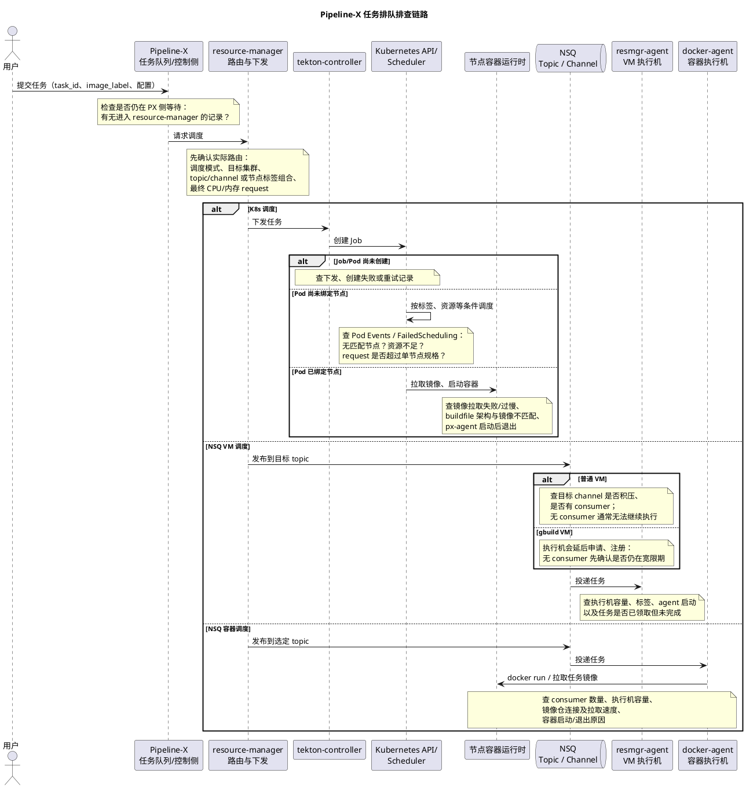

# CI流水线资源排队-需求分析

## 问题和痛点

如下问题在用户侧看来都是排队，没有细化原因：
（1）pipeline-x构建任务瞬时很高，大量排队等待构建资源（具体细分为在px侧排队、在k8s/nsq调度侧排队）（2）镜像拉不下来（执行机没有配镜像仓到insecure-registry永远无法启动、镜像平均20G+导致确实在拉镜像/镜像仓负载异常偏高导致拉的速度很慢）（3）gbuild云龙任务找不到执行机（云龙资源不足、云龙标签配错导致resmgr-agent arm二进制启动在x86节点上）（4）buildfile中arch和镜像不匹配导致任务起不来（5）内存预测值异常偏高导致超执行机规格，调度不到对应执行节点
（6）px-agent启动异常（Redis解析异常、ctrl/agent侧的msg不兼容变更），px-agent启动报错容器直接退出

根据调度方式总结常见排队问题原因：

（1）通用问题：资源（cpu/mem/pod数量）不足：
a. 业务任务量高峰，队列量是容量上限20% or 10个以内，但任务本身正常，在排队并等待一段时间后可以排到
b. 有20%以上的，多达300% - 500%的队列量，可能是有单点误调试下发大量流水线，或者某类任务大量卡死占用容器
（2）容器k8s pod模式：容器镜像拉取不到，大量容器挂死在拉不到镜像，但还占用请求资源。并且这种是永远不会启动的，但并不会报错，服务端30分钟拉不起来还会重试叠加排队。
（3）vm模式-普通：topic不存在，但是也会下发到nsq消息队列，一直没有vm执行机消费。
（4）vm模式-gbuild：topic在任务下发时可能不存在，但是等待一段时间后vm会申请到并注册，任务可以继续执行。

运维痛点（PX开发）：

1. 先于用户感知，排查排队的问题，给排查范围：
   1.1、排队无告警，靠用户反馈排查
   1.2、调度规则复杂，路由到不同模式不同集群。看到某个任务排队时，需要先找这个任务调度的集群、节点标签，再一个个看对应节点的正在运行哪些任务
   1.3、无法看到某某集群中的僵尸任务数量和列表，靠人工看 是什么任务大量运行/卡死 导致后续任务排队。
2. 资源数量容量、变化趋势分析，闲忙合理性分析：

2.1、调度固定：标签的节点使用量的历史统计，能审视到底是不是任务量确实有分布上的变化，某类集群需要的资源量变多，需要根据业务量分布变化定期调整资源量，空闲的集群/标签定期缩减，繁忙的适当增加
2.2、调度动态：新的一批大规模任务，到底适合分配到哪个集群。session独占的集群划分
2.3. request: 需要能够分析出用户显式指定的request是否合理，不合理的给出分析建议。

用户痛点：

1、用户侧只显示排队原因，整体队列数量
2、特殊紧急mr需要先于所有其他任务被调度到（不在resource-manager实现，在上层pipeline-x实现）

## 诉求

1、优先解决采集保存，可以定时15s采集一次集群信息保存到clickhouse，然后通过grafana进行告警。存到clickhouse的数据也可以用现有看板分析忙闲时
2、优先解决运维诉求
3、用户侧只显示排队原因，不做排队位置预估，在运维诉求基础上不做复杂逻辑，部分监控信息以api返回给前端用户侧。
4、功能设计不要过于复杂实现工作量大，希望实现工作量在15人天
5、实现方式不影响现有调度

## 目标功能

1. 任意任务可以查询到目标集群、调度类型、topic或节点标签组。（能否通过追踪实现）
2. K8s排队任务中，能区分资源不足、标签不匹配和镜像拉取失败。
3. NSQ能够识别有积压但无consumer的topic、镜像拉取失败、资源不足。
4. gbuild无consumer不会立即误报，超过宽限期才告警。
5. Grafana能按集群和标签组合查看容量、运行量、排队量。
6. 能查看当前僵尸任务数量和任务列表。
7. 关键异常在5～10分钟内触发告警。
8. observer或ClickHouse故障不影响现有任务调度。

**最关键的范围控制是：不改调度决策，只做“路由信息补齐、状态采集、规则诊断、看板告警和查询API”。** 能优先解决运维排查和无告警的问题。


# CI 流水线排队原因排查指导书

> **用途**：在监控和诊断能力完善之前，从一条排队任务出发，确认它**停在哪一段链路**、**为什么没有继续执行**，并留下可复核的证据。

## 一、先看完整链路



## 二、排查入口：先定位“卡在哪”，再判断“为什么”

收到用户反馈或发现积压后，先固定**一条典型任务**和**同一时段的积压范围**。不要仅凭“队列总数高”判断资源不足。

| 步骤 | 必须确认的问题 | 记录结果 |
|---|---|---|
| 1. 固定任务 | 任务 ID、流水线 ID、提交及开始排队时间、最近一次状态变化时间、`image_label`、`buildfile` 中的 `arch`、用户填写的 CPU/内存 request | `[待填写]` |
| 2. 区分排队位置 | 任务还在 PX 侧，还是已经进入 `resource-manager`？是否有下发成功记录？ | `[待填写]` |
| 3. 还原**实际路由** | 调度模式（K8s / NSQ VM / NSQ 容器）、目标集群、K8s 节点选择条件或 NSQ topic/channel；不要只按 `image_label` 猜测 NSQ 容器模式的 topic | `[待填写]` |
| 4. 找到下游对象 | K8s 的 Job/Pod 名称与 UID；或 NSQ 的 topic、**实际消费 channel**、消息/任务关联标识、consumer | `[待填写]` |
| 5. 确认停滞阶段 | 未下发、未创建、未绑定节点、拉镜像、启动后退出、消息未消费、已消费但执行不结束 | `[待填写]` |
| 6. 判断影响范围 | 同集群、同标签组合或同 topic/channel 的排队量、运行量、最老任务等待时间及变化趋势 | `[待填写]` |

**查询不到实际路由或下游对象时，不要跳到“资源不足”结论。** 先将其标为“链路定位未完成”，用任务 ID 与时间窗口关联 PX、`resource-manager`、controller/agent 的日志和追踪。具体检索字段、Jaeger 操作路径在文末补充。

## 三、按调度模式排查

### A. 任务仍在 PX 侧，或尚未确认成功下发

1. 找到该任务最近一次状态变更、调度请求及重试记录，确认是否真正调用了 `resource-manager`。
2. 同时看 PX 侧同类任务的队列量、入队速率和出队速率。若大量任务尚未下发，下游集群空闲也不能排除 PX 侧排队。
3. 若有下发记录，核对返回结果和后续重试：**请求发出**不等于**下游已接受并创建 Job/发布消息**。

**判定口径**：以可关联的下游创建或发布证据为界。仅有用户侧“排队”状态，不能判定已经到 K8s 或 NSQ。

**具体案例及查询方法**：`[待补充]`

### B. K8s 调度

先确认目标集群和 Job/Pod。**Job/Pod 尚不存在**时查 `resource-manager → tekton-controller → Kubernetes API` 的创建链路；**Pod 已存在**时，看 Pod 是否绑定节点，再看容器状态与 Events。Kubernetes 官方排查流程也建议先检查 Pod 当前状态、容器状态及近期 Events。([kubernetes.io](https://kubernetes.io/docs/tasks/debug/debug-application/debug-pods/))

| 现场证据 | 优先排查方向 | 如何与其他原因区分 |
|---|---|---|
| Pod 未绑定节点；调度事件提示节点不满足选择条件 | **标签/约束不匹配** | 对照任务要求的完整标签组合与实际节点标签；例如同时核对 `role` 和 `os.name`，不能分别统计两项的节点数后认为存在交集。 |
| Pod 未绑定节点；调度事件提示 CPU、内存或可容纳 Pod 数不足 | **资源不足** | 只统计符合**全部调度约束**且可调度的节点；核对可分配量、已占用 request、Pod 容量，而非整个集群总量。 |
| Pod 未绑定节点；最终内存 request 大于候选单节点可承载规格 | **request 异常偏高／无可用节点规格** | 同时记录用户显式 request、历史统计值和最终采用值；按当前“取两者较大值”的逻辑核查，不能只看用户填写值。 |
| Pod 已绑定节点；容器等待，Events/容器状态显示镜像拉取错误或反复重试 | **镜像拉取失败** | 区分镜像地址/认证或仓库连接配置问题、仓库异常、镜像过大导致拉取慢；记录原始错误及持续时间。已绑定后卡在拉镜像，不应归类为调度器“无匹配节点”。 |
| Pod 已绑定节点；镜像已拉取，容器启动失败或退出 | **架构不匹配／px-agent 启动异常** | 核对 `buildfile.arch`、节点架构、镜像实际架构；再看容器退出原因及 `px-agent` 日志中的 Redis 解析或消息兼容性错误。 |
| 相同标签组合下，运行任务长期不结束，随后排队增多 | **疑似僵尸任务占用容量** | 列出任务 ID、运行时长、最后进展时间、占用 request；“运行久”只是筛选条件，需核实确实无进展后再认定僵尸任务。 |

**注意**：镜像拉取失败可能让已绑定 Pod 持续占用其请求资源，并使后续任务出现资源不足；值班结论应写明**上游诱因（拉镜像失败）**和**下游表现（容量被占、后续排队）**，不要只写“资源不足”。Pod 生命周期中的调度、镜像拉取和容器启动是不同阶段，应分别取证。([kubernetes.io](https://kubernetes.io/docs/concepts/workloads/pods/pod-lifecycle/))

**具体案例及查询方法**：`[待补充]`

### C. NSQ 调度：先确认 topic，**再确认 channel 和 consumer**

`image_label` 在普通 VM 模式下对应 topic；NSQ 容器模式下还存在按任务名称、branch 等选取 topic 的逻辑，必须以**实际下发路由**为准。检查积压时应落到实际消费的 channel：NSQ 的一个 topic 可以有多个 channel，各 channel 独立接收和缓冲消息，不能只看 topic 名称或汇总量就判断这批任务为何未消费。([nsq.io](https://nsq.io/overview/design.html))

| 现场证据 | 排查结论方向 | 下一步 |
|---|---|---|
| 目标 channel 持续积压，consumer 为 0 | **无人消费** | 核对 topic/channel、执行机是否应存在、agent 是否注册成功；区分普通 VM 与 gbuild。 |
| 普通 VM 模式下，目标 topic/channel 无对应执行机消费 | **topic/consumer 配置或执行机缺失** | 核对发布与订阅名称、执行机标签及 agent 进程；不要因为“消息发布成功”就认为有人会领取。 |
| gbuild 模式下暂时无 consumer | **可能处于执行机申请/注册等待期** | 记录任务下发时间、资源申请与 agent 注册进度；**超过经确认的宽限期**且仍无 consumer 才按异常升级。宽限期具体值：`[待补充]`。 |
| consumer 存在但积压增长、领取速度低 | **容量不足或消费异常** | 比较入队、领取、完成趋势；查执行机可用数、正在运行任务及异常长任务。不能仅凭 consumer 数大于 0 判定容量充足。 |
| 消息已领取，任务迟迟未开始或未结束 | **agent／启动链路／运行任务问题** | 查领取它的执行机及 agent 日志；NSQ 容器模式重点看 `docker run`、镜像拉取和容器退出。 |
| gbuild 执行机长期注册不上 | **云龙容量、标签或 agent 架构问题** | 查资源申请结果、标签配置；核对是否出现 ARM 版 `resmgr-agent` 在 x86 节点启动等错误。 |

记录 NSQ 现场数据时，分别写明 **channel 积压、in-flight、consumer/client 数及其时间变化**，不要把 `RDY` 当作“排队任务数”。NSQ 官方指标分别提供 channel 的 `depth`、`clients`、`in_flight_count` 等字段；实际监控面板若使用 `rdy` 或自行计算的 `inflight+rdy`，需要先核实其采集和聚合口径。([nsq.io](https://nsq.io/components/nsqd.html))

**NSQ 容器模式的额外检查**：若任务已被 `docker-agent` 领取，重点检查节点镜像仓连接配置（包括所需的 `insecure-registry`）、认证/网络、镜像大小、仓库负载、拉取进度及 `docker run` 错误。此时“NSQ 无 consumer”与“消费后拉镜像失败”是两种不同故障。

**具体案例及查询方法**：`[待补充]`

## 四、共性判断：正常高峰、异常突增，还是任务卡死

以下比例只作为**排查线索，不作为自动定性阈值**：

- **短时高峰**：队列量约在容量上限的 20% 或 10 个以内，任务持续被领取、完成，最老等待时间没有持续增长。记录趋势后观察，不能仅凭有队列就判故障。
- **异常突增**：队列达到容量的 20% 以上，甚至 100%～500%，先查是否单点调试批量下发流水线，再查某一类任务是否大量卡死占用执行容量。
- **容量被长期占用**：核对正在运行任务的数量、持续时长、最后进展和资源占用；从候选列表中确认僵尸任务，避免直接清理仍在正常执行的大任务。
- **只影响特定路由**：如果其他集群、标签组合或 topic 正常，应缩小到受影响的路由，而不是按全局资源不足处理。

## 五、辅助定位工具

1、排队任务的pipeline-x任务日志、buildinfo
（1）日志`[pipeline-x-ctrl]`前缀的是px-ctrl侧的调度/排队日志
（2）buildinfo中request_res字段下cpu、memory， 是根据用户buildfile指定和历史统计较高者，是实际启动k8s pod/nsq容器时的资源请求量。
2、[jaeger追踪看板](http://7.183.88.109:32000/search)
（1）看到任务下发在pipeline-x、resource-manager、nsq、resmgr-agent、px-agent哪一步异常、每一步耗时多久
（2）看到每一个进程内部打点的关键信息，如topic/集群标签、容器镜像等
3、[elk日志看板](http://7.183.88.109:30822/app/kibana#/discover?_g=()&_a=(columns:!(_source),index:d993b8d0-8987-11ec-aa75-bd5a8ca3a2cd,interval:auto,query:(language:kuery,query:''),sort:!('@timestamp',desc)))（pipeline-x、resource-manager服务端日志）
（1）用排队任务的job_id、package_name等关键字，找到比1.1更详细的服务端日志
4、[容器任务数量监控看板](http://7.220.90.196:3000/d/TPz3wdrHz/zhi-xing-rong-qi-shu-liang?orgId=1&from=now-24h&to=now)
5、nsq队列前端: [vm/gbuild构建](http://7.183.88.109:30010/), [容器构建](http://7.183.88.109:30030/)
确认nsq各个topic下的实时任务Rdy/Inflight/Depth数量，确认每个topic下执行机数量是否正常
6、rancher上k8s的job数量用于
查看job启动是否正常，是否有大规模容器启动失败（镜像拉取失败、agent启动快速失败）
7、pipeline-x的metabase查询数据库
查看流水线数量、任务数量是否正常，过滤特定条件的任务，一般需要改动sql加特定条件。
8、log-gbuild日志，gbuild标签的resmgr-agent的运行日志
查云龙vm/容器内的resmgr-agent是否启动正常、日志上任务是否正常

## 六、排队定位方法论

前面章节给出了链路、入口表、按调度模式排查的方向、共性判断和工具清单。实际排查时按以下 **7 步通用流程** 串联使用：先固定证据、再沿链路逐段定位卡点、最后定性并匹配处置。每一步都标注了对应章节和工具，避免跳步直接下结论。

### 步骤 1：固定样本与影响范围（对应第二章步骤 1、6）

- **做什么**：收到反馈或发现积压后，**不要凭"队列总数高"判断资源不足**。先固定一条最老的排队任务作为样本，同时框定同一时段的积压范围（同集群/同标签/同 topic-channel）。
- **看什么**：任务 ID、流水线 ID、提交与开始排队时间、最近状态变化时间、`image_label`、`buildfile.arch`、用户填写的 CPU/内存 request；同路由下的排队量、运行量、最老等待时间及变化趋势。
- **判什么**：是单任务异常还是批次异常；趋势是持续增长（疑似故障）还是波动后回落（疑似高峰）。
- **工具**：pipeline-x 任务日志/buildinfo（工具 1）、metabase（工具 7）、容器任务数量监控看板（工具 4）。

### 步骤 2：区分排队位置——还在 PX 侧，还是已下发（对应第二章步骤 2、第三章 A）

- **做什么**：以**可关联的下游创建或发布证据**为界。用 job_id 在 elk 检索 `resource-manager` 下发记录。
- **判什么**：
    - 检索不到下发记录 → **仍在 PX 侧**，查 PX 调度能力与队列出队速率，勿扩容下游。
    - 有下发记录但无下游对象 → 查 `resource-manager → tekton-controller/NSQ` 的创建/发布链路（未创建阶段）。
    - 有下游对象 → 进入步骤 3。
- **关键原则**：**请求发出 ≠ 下游已接受**，仅有用户侧"排队"状态不能判定已到 K8s/NSQ。
- **工具**：elk（工具 3）、jaeger（工具 2）。

### 步骤 3：还原实际路由，不要按 image_label 猜测（对应第二章步骤 3、第三章 C）

- **做什么**：确认调度模式（K8s / NSQ VM / NSQ 容器）、目标集群、K8s 节点选择条件或 NSQ **实际消费 channel**。
- **判什么**：NSQ 容器模式下 topic 按任务名/branch 选取，必须以实际下发路由为准；一个 topic 多个 channel 独立缓冲，不能只看 topic 汇总量。
- **工具**：jaeger 进程内打点（topic/集群标签，工具 2）、buildinfo、NSQ 队列前端（工具 5）。

### 步骤 4：找到下游对象，锁定停滞阶段（对应第二章步骤 4、5，第三章 B/C）

- **做什么**：K8s 记 Job/Pod 名称与 UID；NSQ 记 topic、实际 channel、消息标识、consumer。然后按下表把停滞阶段对应到排查方向：

| 停滞阶段 | 优先排查方向 | 区分要点 |
|---|---|---|
| 未下发 | PX 侧调度/队列消费 | 步骤 2 已判定 |
| 未创建 | resource-manager→controller 创建链路 | 有下发记录但无 Job/Pod、无 NSQ 消息 |
| 未绑定节点 | 标签/约束不匹配、资源不足、request 超规格 | Pod Events 的 FailedScheduling 原因；只统计满足**全部**约束的节点 |
| 拉镜像 | 拉取耗时长 / 拉取失败 | Pod 已绑定；区分慢（镜像大/仓库负载）与失败（认证/insecure-registry/tag 不存在） |
| 启动后退出 | arch 与镜像不匹配 / px-agent 启动异常 | 容器退出码与日志；`exec format error` 或 panic/Redis 报错 |
| 消息未消费 | 无 consumer / consumer 未注册 | rdy=0；区分普通 VM、gbuild 宽限期内、agent 注册失败 |
| 已消费不结束 | agent/运行任务问题、僵尸任务占用容量 | 查领取执行机 agent 日志；运行久≠僵尸，需核实无进展 |

- **关键原则**：Pod 的调度、拉镜像、容器启动是不同阶段，**分别取证**；镜像拉取失败会让已绑定 Pod 持续占用 request，上游诱因与下游表现要分别写明。
- **工具**：rancher（工具 6）、NSQ 队列前端（工具 5）、log-gbuild（工具 8）、jaeger（工具 2）。

### 步骤 5：判断共性类型（对应第四章）

- **做什么**：结合步骤 1 的影响范围与步骤 4 的停滞阶段，按共性判断定性：
    - 短时高峰：队列约容量 20% 或 10 个以内，持续被领取完成 → 观察，不判故障。
    - 异常突增：达 20% 以上至 100%～500% → 先查单点调试批量下发，再查某类任务卡死占容量。
    - 容量被长期占用：核对运行任务数量、时长、最后进展、占用 request → 从候选确认僵尸任务，勿误清正常大任务。
    - 只影响特定路由：其他集群/标签/topic 正常 → 缩小到受影响路由，勿按全局资源不足处理。
- **关键原则**：比例只是排查线索，**不作为自动定性阈值**。

### 步骤 6：匹配案例与处置方向（对应第七章案例）

- **做什么**：根据步骤 4 锁定的停滞阶段和步骤 5 的共性类型，到第七章对照同类案例，复用其定位步骤与处置方法：
    - PX 侧/调度侧排队 → 案例 7.1
    - 拉镜像耗时长/失败 → 案例 7.2
    - gbuild 找不到执行机 → 案例 7.3
    - arch 与镜像不匹配 → 案例 7.4
    - 内存预测值异常偏高 → 案例 7.5
    - px-agent 启动异常 → 案例 7.6
- **关键原则**：案例提供路径参考，**仍需以当前任务的实际证据为准**，不要套用结论。

### 步骤 7：留存证据并处置

- **做什么**：处置后回写结论，包含**上游诱因**与**下游表现**两层（如"镜像拉取失败→容量被占→后续排队"），不要只写"资源不足"。记录任务 ID、时间窗口、关键日志/截图、最终采用值（如 request 取用户值与预测值的较大者）。
- **关键原则**：查询不到实际路由或下游对象时，标为"链路定位未完成"，用任务 ID + 时间窗口关联 PX、resource-manager、controller/agent 日志和追踪，**不要跳到"资源不足"结论**。

> 速查口诀：**固定样本 → 找下发证据 → 还原实际路由 → 锁停滞阶段 → 定共性类型 → 对案例处置 → 写诱因+表现**。

## 七、排队定位案例

### 7.1 任务瞬时很高，大量排队等待构建资源（具体细分为在px侧排队、在k8s/nsq调度侧排队）

任务瞬时高峰时，需先区分排队发生在 PX 侧还是已经在 K8s/NSQ 调度侧等待。两类现象相似（前端均显示排队），但下游对象和处置方向不同，必须按第2章入口表逐项确认后再定性。

#### 5.1.1 PX 侧排队（任务尚未成功下发到 resource-manager）

| 步骤 | 记录结果 |
|---|---|
| 1. 固定任务 | `[待填写]`：以高峰期一条最老排队任务为样本 |
| 2. 区分排队位置 | **仍在 PX 侧**：elk 中按 job_id 检索不到 `resource-manager` 的下发记录，PX 侧队列量与前端排队量一致 |
| 3. 还原实际路由 | `[待填写]`：调度模式尚未到达，无需还原实际路由 |
| 4. 找到下游对象 | **无下游对象**：未生成 Job/Pod，未发布 NSQ 消息 |
| 5. 确认停滞阶段 | **未下发**：任务停留在 PX 调度队列，等待 PX 侧出队 |
| 6. 判断影响范围 | PX 侧同类任务入队速率远大于出队速率，下游集群/NSQ 空闲；最老等待时间持续增长 |

**判定口径**：以下游创建或发布证据为界，未检索到 `resource-manager` 下发记录时不能判定已到 K8s/NSQ。处置方向应优先查 PX 侧调度能力、队列消费速率，而非扩容下游执行资源。

#### 5.1.2 K8s/NSQ 调度侧排队（任务已下发，下游容量不足）

| 步骤 | 记录结果 |
|---|---|
| 1. 固定任务 | `[待填写]`：以高峰期一条已下发但仍 Pending 的任务为样本 |
| 2. 区分排队位置 | **已下发**：elk 中可检索到 `resource-manager` 下发成功记录 |
| 3. 还原实际路由 | `[待填写]`：K8s 模式记录集群与节点标签组合；NSQ 模式记录实际 topic/channel，不要按 `image_label` 猜测 |
| 4. 找到下游对象 | K8s：Job/Pod 已创建但 Pending；NSQ：消息已发布到目标 channel，consumer 数 > 0 但 depth 持续增长 |
| 5. 确认停滞阶段 | K8s：**未绑定节点**，Pod Events 提示资源不足；NSQ：**消息未消费/消费速度低**，入队大于领取 |
| 6. 判断影响范围 | 受影响路由排队量达到容量 20% 以上，其他集群/标签组合/topic 正常；最老等待时间持续增长 |

**判定口径**：已下发且下游有积压时，先按"共性判断"区分短时高峰与异常突增。短时高峰观察趋势即可；异常突增需进一步查是否单点调试批量下发、是否某类任务大量卡死占用执行容量。

### 7.2 镜像拉取耗时长/拉取失败

（执行机没有配镜像仓到insecure-registry永远无法启动、镜像平均20G+导致确实在拉镜像/镜像仓负载异常偏高导致拉的速度很慢）

#### 耗时长-k8s调度任务：

| 步骤 | 记录结果 |
|---|---|
| 1. 固定任务 | job_id=643333148406504685；任务名=cv_label@@4a1297f55c；等待:17m47s，执行:17m58s |
| 2. 区分排队位置 | **已下发**：日志中可看到 Pod 名称 `job-643333148406504685-...-qxb7k` 已创建 |
| 3. 还原实际路由 | K8s 调度；目标集群与节点标签以 buildinfo 为准 |
| 4. 找到下游对象 | Pod：`job-643333148406504685-e1e61a0976e30b3f-1792986038-qxb7k` |
| 5. 确认停滞阶段 | **拉镜像**：PodScheduled 出现于 11:40:38，podRunning 于 11:58:21，期间 Pod 已绑定节点但卡在镜像拉取，耗时 17m43s |
| 6. 判断影响范围 | 单任务现象；若同集群同镜像多任务并发，拉取耗时会被放大，需结合镜像仓负载与镜像大小共同判断 |

**关键信息来源**：1、排队任务的 pipeline-x 任务日志

| 事项 | 描述 |
| ------ | -------------------------- |
|job_id|643333148406504685|
|任务名称|cv_label@@4a1297f55c|
| 耗时 | 执行:17m58s; 等待:17m47s |
| 关键信息来源 | 1、排队任务的pipeline-x任务日志 |

排队17分钟，在拉取一个大的构建容器镜像，从PodScheduled第一次出现（11:40:38）一直到podRunning（11:58:21）耗时17m43s

```
2026-10-26 11:40:38 [pipeline-x-ctrl] Time:2026-10-26 11:40:38,Name:,Phase:,Reason:,Conditions:
2026-10-26 11:40:38 [pipeline-x-ctrl] Time:2026-10-26 11:40:38,Name:job-643333148406504685-e1e61a0976e30b3f-1792986038-qxb7k,Phase:Pending,Reason:,Conditions:PodScheduled
2026-10-26 11:40:38 [pipeline-x-ctrl] Time:2026-10-26 11:40:38,Name:job-643333148406504685-e1e61a0976e30b3f-1792986038-qxb7k,Phase:Pending,Reason:,Conditions:PodScheduled
2026-10-26 11:41:52 [pipeline-x-ctrl] Time:2026-10-26 11:41:52,Name:job-643333148406504685-e1e61a0976e30b3f-1792986038-qxb7k,Phase:Pending,Reason:,Conditions:PodScheduled
2026-10-26 11:51:52 [pipeline-x-ctrl] Time:2026-10-26 11:51:52,Name:job-643333148406504685-e1e61a0976e30b3f-1792986038-qxb7k,Phase:Pending,Reason:,Conditions:PodScheduled
2026-10-26 11:58:21 [pipeline-x-ctrl] Time:2026-10-26 11:58:21,Name:job-643333148406504685-e1e61a0976e30b3f-1792986038-qxb7k,Phase:Running,Reason:Pod is running,Conditions:podRunning

```

#### 耗时长-nsq调度任务：

| 步骤 | 记录结果 |
|---|---|
| 1. 固定任务 | job_id=642243357397018434；任务名=increment_webhook；等待:3m24s，执行:3m47s；镜像 `pximage.inhuawei.com/pipeline-x/euleros_v2r12c00spc100b150_x86_ci_8.1.0:product-7.46` |
| 2. 区分排队位置 | **已下发**：日志中可看到 `docker run` 命令已下发到 docker-agent |
| 3. 还原实际路由 | NSQ 容器调度；`EXEC_CLUSTER='custom-docker'`；消息已由 docker-agent 领取 |
| 4. 找到下游对象 | docker-agent 容器名 `container-642243357397018434-1cd15a581b520b6b-1792336502`；节点 IP 7.224.96.122 |
| 5. 确认停滞阶段 | **拉镜像**：23:15:02 开始 `Pulling fs layer`，23:18:19 `Downloaded newer image`，耗时 3m17s；消息已消费但容器未启动完成 |
| 6. 判断影响范围 | 单任务现象；若同节点/同镜像并发拉取，需结合镜像仓负载、镜像大小、`insecure-registry` 配置共同排查 |

**关键信息来源**：1、排队任务的 pipeline-x 任务日志

| 事项 | 描述 |
| ------ | -------------------------- |
|job_id|642243357397018434|
|任务名称|increment_webhook|
| 耗时 | 执行:3m47s; 等待:3m24s |
| 关键信息来源 | 1、排队任务的pipeline-x任务日志 |

从开始拉取
`2026-10-18 23:15:02 product-7.46: Pulling from pipeline-x/euleros_v2r12c00spc100b150_x86_ci_8.1.0`
直到
`2026-10-18 23:18:19 Status: Downloaded newer image for pximage.inhuawei.com/pipeline-x/euleros_v2r12c00spc100b150_x86_ci_8.1.0:product-7.46`
耗时3min17s

```
2026-10-18 23:15:02[pipeline-x] command:{0s [/bin/bash -c sudo docker run --oom-score-adj=600 --rm -e NODE_IP='7.224.96.122' -e HOST_IP='7.224.96.122' -e PUBLISH_TYPE='product' -e BUILD_ENVIRONMENT='product' -e EXEC_CLIENT_NAME='container-642243357397018434-1cd15a581b520b6b-1792336502' -e EXEC_CLUSTER='custom-docker' -e WORKSPACEHOST='/usr1/home/workspace/x/w/d754840786a32a59' -e WORKSPACEDOCKER='/usr1/home/workspace/x/w/d754840786a32a59' -v /usr1/home/workspace/x/w/d754840786a32a59:/usr1/home/workspace/x/w/d754840786a32a59 -v /usr1/.cache:/usr1/.cache -v /usr1/tmp:/usr1/tmp -v /usr1/home/workspace/x/w/log:/usr1/home/workspace/x/w/log -v /usr1/mvnRepository:/usr1/mvnRepository -v /usr1/local:/usr1/local -v /usr1/samedep/metadata/lock:/usr1/samedep/metadata/lock -v /var/run/docker.sock:/var/run/docker.sock --name container-642243357397018434-1cd15a581b520b6b-1792336502 --net=host --privileged pximage.inhuawei.com/pipeline-x/euleros_v2r12c00spc100b150_x86_ci_8.1.0:product-7.46 /bin/bash -c '/bin/tini -- /opt/app/pipeline-x agent -job_id 642243357397018434 -task_id increment_webhook'] [] /usr1/home/workspace/x/w/log/d754840786a32a590be6/run.log false <nil>}
2026-10-18 23:15:02 Unable to find image 'pximage.inhuawei.com/pipeline-x/euleros_v2r12c00spc100b150_x86_ci_8.1.0:product-7.46' locally
2026-10-18 23:15:02 product-7.46: Pulling from pipeline-x/euleros_v2r12c00spc100b150_x86_ci_8.1.0
2026-10-18 23:15:02 ee0d7f0a2819: Pulling fs layer
2026-10-18 23:15:02 7c96d154506c: Pulling fs layer
2026-10-18 23:15:02 3c872643d680: Pulling fs layer
...
2026-10-18 23:18:18 331cafd54903: Pull complete
2026-10-18 23:18:19 Digest: sha256:357a17b3c0c96060900020a5942b761aee92270d6fabe6d0cec4f613f2202942
2026-10-18 23:18:19 Status: Downloaded newer image for pximage.inhuawei.com/pipeline-x/euleros_v2r12c00spc100b150_x86_ci_8.1.0:product-7.46

```

#### 拉取失败-k8s调度任务：

镜像拉取失败与拉取耗时长同属"Pod 已绑定节点但卡在拉镜像"阶段，区别在于 Events 中出现 `ImagePullBackOff`/`ErrImagePull` 且反复重试，而非缓慢推进。排查入口表如下：

| 步骤 | 记录结果 |
|---|---|
| 1. 固定任务 | `[待填写]`：以出现 `ImagePullBackOff` 的任务为样本 |
| 2. 区分排队位置 | **已下发**：Job/Pod 已创建 |
| 3. 还原实际路由 | K8s 调度；记录目标集群与节点标签组合 |
| 4. 找到下游对象 | Pod 已绑定节点；Events 中有 `ImagePullBackOff`/`ErrImagePull` |
| 5. 确认停滞阶段 | **拉镜像（失败）**：区分镜像地址/认证错误、镜像仓连接异常、镜像不存在；记录原始错误及重试次数 |
| 6. 判断影响范围 | 若同镜像多任务同时失败，多为镜像仓/认证问题；若仅个别任务失败，优先查镜像地址拼写与 tag 是否存在 |

**处置要点**：拉取失败的 Pod 仍占用其 request 资源直到被清理，会放大下游排队。需在 Events 中区分 `http: server gave HTTP response to HTTPS client`（缺 `insecure-registry`）、`manifest unknown`（tag 不存在）、`authentication required`（认证配置问题）等不同错误，再决定是修节点配置、修镜像仓配置还是修正 buildfile 中的镜像引用。

#### 拉取失败-nsq调度任务：

NSQ 容器模式下，任务已被 docker-agent 领取后拉取失败，现象是任务一直不结束、容器未成功启动。与"NSQ 无 consumer"是两种不同故障，需按入口表确认。

| 步骤 | 记录结果 |
|---|---|
| 1. 固定任务 | `[待填写]`：以 docker-agent 领取后拉镜像失败的任务为样本 |
| 2. 区分排队位置 | **已下发**：NSQ 消息已被 docker-agent 领取（in-flight 转 0 或保持领取状态） |
| 3. 还原实际路由 | NSQ 容器调度；记录实际 topic/channel 与执行机节点 |
| 4. 找到下游对象 | docker-agent 日志中可见 `docker run` 命令及镜像拉取错误；执行机节点需确认 `insecure-registry` 配置 |
| 5. 确认停滞阶段 | **拉镜像（失败）**：区分节点未配 `insecure-registry`、镜像仓连接/认证失败、镜像不存在；与"消息未消费"区分的关键是 docker-agent 是否已领取 |
| 6. 判断影响范围 | 若同节点同镜像多任务失败，多为节点 `insecure-registry`/镜像仓连接问题；NSQ 队列侧表现为消息被领取但长期不 ACK |

**处置要点**：执行机节点若未将镜像仓配到 `insecure-registry`，`docker pull` 会因 HTTPS/HTTP 协议不匹配永远无法启动，需修正 docker daemon 配置后重启。

### 7.3 gbuild云龙任务找不到执行机

云龙标签配错导致resmgr-agent arm二进制启动在x86节点上

| 步骤 | 记录结果 |
|---|---|
| 1. 固定任务 | job_id=634618770173748128；任务名=5gcore/sf/patch/arm/softpkg_test-cspomb 等多个任务；arch=arm；image_label=`gbuild_3BB0CSMC_sf_euleros_v2r15c10spc003b110_arm64_build_10.0.2`；执行:2h20m20s，等待:0s，resultCode:Timeout |
| 2. 区分排队位置 | **已下发**：NSQ 消息已发布到目标 topic，但无 consumer 领取 |
| 3. 还原实际路由 | NSQ VM 调度（gbuild）；目标 topic=`gbuild_3BB0CSMC_sf_euleros_v2r15c10spc003b110_arm64_build_10.0.2`；按 arch 选取 topic，arm 实际应为 `arm_gbuild_...` |
| 4. 找到下游对象 | NSQ topic 下 rdy 一直为 0，无 consumer；CB2.0 上 arm_vm 的 client/agent 显示 tbuild_execute 已启动 |
| 5. 确认停滞阶段 | **消息未消费**：执行机已分配且 tbuild 已启动，但 resmgr-agent 未注册成功，关键日志 `Build resource rdy is 0` |
| 6. 判断影响范围 | 仅 arm 路由受影响；同 image_label 多个任务均 timeout，rdy 持续为 0 |

**关键信息来源**：1、gbuild 日志

| 事项 | 描述 |
| ------ | -------------------------- |
|job_id|634618770173748128|
|任务名称|5gcore/sf/patch/arm/softpkg_test-cspomb等多个任务|
| 耗时 | timeout 执行:2h20m20s; 等待:0s |
| 关键信息来源 | 1、gbuild日志 |


```
2026-08-27 11:11:59 [pipeline-x-ctrl] resultCode:Timeout, retryTimes:3, runTime:2026-08-27 10:36:59, clientIP: , agentLogWorkSpcae:/usr1/home/workspace/x/w/log/f6aaa3dfc131010fafc2, failureReason: timeout
```

#### 定位步骤&原因

1、确认是nsq对应topic下rdy一直是0，找不到nsq consumer执行，关键日志

```
Build resource rdy is 0, contact Px admin to check resource server status
```


2、确认任务的image_label、arch、container字段，确认任务是使用arm的vm的标签

```json
{
    "arch": "arm",
    "image_label": [
        "gbuild_3BB0CSMC_sf_euleros_v2r15c10spc003b110_arm64_build_10.0.2"
    ],
    "request_res": {
        "cpu": 2769,
        "memory": 4096,
        "cost_second": 180
    },
    "overwrite_container": {
        "negativity_condition": [
            {
                "image_label": "^gbuild_"
            }
        ],
        "weight": 100
    }
}
```

3、点击到CB2.0的链接，找arm_vm的client 、agent，每个点进去看一下tbuild_execute启动是正常的，说明云龙机器也分配到了且tbuild启动了。


3、现在可以确认问题是cb执行机上的resmgr-agent没有启动、pipelinex_monitor.sh
没注册成功。需要看arm_vm的client tbuild_execute对应的日志，下载下来搜索pipelinex_monitor.sh，看到日志如下

```
[2026/08/27 09:00:29.619 GMT+08:00] imageLabelByArch: {x86=[euleros_v2r15c10spc003b110_x86_build_10.0.2], arm=[euleros_v2r15c10spc003b110_arm64_build_10.0.2]}
[2026/08/27 09:00:29.619 GMT+08:00] [GBuild]不同arch机器使用的topic情况: {x86=[gbuild_3BB0CSMC_sf_euleros_v2r15c10spc003b110_x86_build_10.0.2], arm=[arm_gbuild_3BB0CSMC_sf_euleros_v2r15c10spc003b110_arm64_build_10.0.2]}
[2026/08/27 09:00:29.619 GMT+08:00] [shell exec command]: wget -t1 -T2 -P ***//gbuild-tools http://7.183.28.77:9155/pipeline-x-arti/pipeline-x-product/pipelinex_monitor.sh
[2026/08/27 09:00:29.619 GMT+08:00] [shell]: --2026-08-27 09:00:27--  http://7.183.28.77:9155/pipeline-x-arti/pipeline-x-product/pipelinex_monitor.sh
[2026/08/27 09:00:29.619 GMT+08:00] [shell]: Connecting to 7.183.28.77:9155... connected.
[2026/08/27 09:00:29.619 GMT+08:00] [shell]: HTTP request sent, awaiting response... 200 OK
[2026/08/27 09:00:29.619 GMT+08:00] [shell]: Length: 7417 (7.2K) [text/x-sh]
[2026/08/27 09:00:29.619 GMT+08:00] [shell]: Saving to: ‘***//gbuild-tools/pipelinex_monitor.sh’
[2026/08/27 09:00:29.619 GMT+08:00] [shell]: 
[2026/08/27 09:00:29.619 GMT+08:00] [shell]:      0K .......                                               100% 1.14G=0s
[2026/08/27 09:00:29.619 GMT+08:00] [shell]: 
[2026/08/27 09:00:29.619 GMT+08:00] [shell]: 2026-08-27 09:00:27 (1.14 GB/s) - ‘***//gbuild-tools/pipelinex_monitor.sh’ saved [7417/7417]
[2026/08/27 09:00:29.620 GMT+08:00] [shell]: 
[2026/08/27 09:00:29.620 GMT+08:00] [shell exec command]: bash ***//gbuild-tools/pipelinex_monitor.sh --label=gbuild_3BB0CSMC_sf_euleros_v2r15c10spc003b110_x86_build_10.0.2
```

关键启动命令是：` bash ***//gbuild-tools/pipelinex_monitor.sh --label=gbuild_3BB0CSMC_sf_euleros_v2r15c10spc003b110_x86_build_10.0.2`，可以看到问题是从arm_vm_agent节点获取的日志，但启动时用的label却是x86的。

点击 构建详细 - 环境信息，发现arm_vm_agent用的云龙资源池是x86的资源池，资源池使用错误


问题已经确认是用户使用资源池错误。

#### 处置方法

后续：用户CIE是从集成工厂启动的任务，构建参数配置错误，出现问题时给build_env_label_arm_vm配置了错误的x86资源池release_5gc_10.1.0_x86_vpc_wh_27.1

### 7.4 buildfile中arch和镜像不匹配导致任务起不来

如果是已注册到config仓的镜像，不会有如下问题会在resource-manager侧校验。如果image_label是用户自定义镜像，会出现如下问题：

| 步骤 | 记录结果 |
|---|---|
| 1. 固定任务 | job_id=643528901355661418；arch=arm；image_label 为用户自定义镜像（未注册到 config 仓，resource-manager 不校验） |
| 2. 区分排队位置 | **已下发**：tekton_run_job 已创建，集群为 romaArmCluster |
| 3. 还原实际路由 | K8s 调度；目标集群=romaArmCluster；按 arch=arm 路由到 ARM 节点 |
| 4. 找到下游对象 | Pod=`job-643528901355661418-56e6abfbaba731c1-1793102721-test-pqxt9`；Phase 由 Pending 转为 Failed |
| 5. 确认停滞阶段 | **启动后退出**：Pod 已绑定节点并拉取镜像，容器启动失败，Reason=Failed to create the container，Conditions=containerFailed；重试任务后看到 `exec user process caused "exec format error"` |
| 6. 判断影响范围 | 仅该用户自定义镜像的任务受影响；已注册镜像因 resource-manager 校验不会出现此类问题 |

#### 定位步骤&原因

1、从日志中找，能看到是containerFailed，找到集群是romaArmCluster

```
2026-10-27 20:05:21 [pipeline-x-ctrl] Time:2026-10-27 20:05:21,Name:tekton_run_job,Phase:clientType:romaArmCluster,affinity:[]
**2026-10-27 20:05:21** [pipeline-x-ctrl] Time:​**2026-10-27 20:05:21**​,Name:,Phase:,Reason:,Conditions:
**2026-10-27 20:05:21** [pipeline-x-ctrl] Time:​**2026-10-27 20:05:21**​,Name:job-643528901355661418-56e6abfbaba731c1-1793102721-test-pqxt9,Phase:Pending,Reason:,Conditions:PodScheduled
**2026-10-27 20:05:21** [pipeline-x-ctrl] Time:​**2026-10-27 20:05:21**​,Name:job-643528901355661418-56e6abfbaba731c1-1793102721-test-pqxt9,Phase:Pending,Reason:,Conditions:PodScheduled
**2026-10-27 20:05:22** [pipeline-x-ctrl] Time:​**2026-10-27 20:05:22**​,Name:job-643528901355661418-56e6abfbaba731c1-1793102721-test-pqxt9,Phase:Pending,Reason:,Conditions:PodScheduled
**2026-10-27 20:05:24** [pipeline-x-ctrl] Time:​**2026-10-27 20:05:24**​,Name:job-643528901355661418-56e6abfbaba731c1-1793102721-test-pqxt9,Phase:Failed,Reason:Failed to create the container,Conditions:containerFailed
**2026-10-27 20:05:25** [pipeline-x-ctrl] Time:​**2026-10-27 20:05:25**​,Name:job-643528901355661418-56e6abfbaba731c1-1793102721-test-pqxt9,Phase:Failed,Reason:Failed to create the container,Conditions:containerFailed
**2026-10-27 20:05:35** [pipeline-x-ctrl] Time:​**2026-10-27 20:05:35**​,Name:job-643528901355661418-56e6abfbaba731c1-1793102721-test-pqxt9,Phase:Failed,Reason:Failed to create the container,Conditions:containerFailed
**2026-10-27 20:05:35** [pipeline-x-ctrl] Time:​**2026-10-27 20:05:35**​,Name:job-643528901355661418-56e6abfbaba731c1-1793102721-test-pqxt9,Phase:Failed,Reason:Failed to create the container,Conditions:containerFailed
```

2、到对应集群上，重试该排队任务，在启动后10s内快速用jobid找job，可以看到启动失败日志，是arch为arm时下载了arm的px-agent
二进制，但是容器镜像本身是x86的所以报错`standard_init_linux.go:246: exec user process caused "exec format error"`


#### 处置方法

修改错误配置，让arch和镜像实际匹配。

### 7.5 内存预测值异常偏高导致超执行机规格，调度不到对应执行节点

| 步骤 | 记录结果 |
|---|---|
| 1. 固定任务 | job_id=643533492558260330；buildinfo 的 `request_res.memory` 异常偏高（以实际值为准）；用户显式 request 与历史统计预测值取较大者 |
| 2. 区分排队位置 | **已下发**：K8s 模式 Job/Pod 已创建；NSQ 模式 resmgr-client 报错 flowCtrl |
| 3. 还原实际路由 | K8s 模式：目标集群；NSQ 模式：实际 topic/channel（任务日志看不到，需走 jaeger 追踪） |
| 4. 找到下游对象 | K8s：Pod=`job-643533492558260330-...-test-s59lq`，Pending；NSQ：jaeger 中 resmgr-client flowCtrl 报错 |
| 5. 确认停滞阶段 | **未绑定节点**：K8s Events 提示 `0/240 nodes are available: 195 Insufficient memory, ...`；NSQ 因 request 超规格被 flowCtrl 拦截 |
| 6. 判断影响范围 | 仅高内存预测值的任务受影响；需对比"用户显式 request"与"历史统计预测值"，确认异常来自哪一侧 |

#### 定位步骤&原因

##### k8s调度

1、查看日志

```
2026-10-27
2026-10-27 20:50:59 [pipeline-x-ctrl] Time:2026-10-27 20:50:59,Name:job-643533492558260330-56e6abfbaba731c1-1793105458-test-s59lq,Phase:Pending,Reason:Waiting to be scheduled: 0/240 nodes are available: 195 Insufficient memory, 3 Too many pods, 3 node(s) were unschedulable, 42 node(s) didn't match Pod's node affinity/selector.,Conditions:resourceWaiting
```

2、看buildinfo的资源请求


##### nsq调度

1、查看追踪（nsq模式任务日志没有办法看到），看到resmgr-client的报错是flowCtrl


2、看buildinfo的资源请求


#### 处置方法

需要确认buildinfo看到的资源请求是用户配置的，还是自动统计的

1、查看buildfile，看是否显示配置了cpu\memory

2、看资源预测值，通过api

### 7.6 px-agent启动异常

| 步骤 | 记录结果 |
|---|---|
| 1. 固定任务 | `[待填写]`：以前端一直显示排队但 Pod/容器已退出、重启的任务为样本 |
| 2. 区分排队位置 | **已下发**：Job/Pod 或 docker-agent 容器已创建并拉取镜像 |
| 3. 还原实际路由 | K8s 或 NSQ 容器调度；记录目标集群/执行机节点 |
| 4. 找到下游对象 | Pod/容器已绑定节点、镜像已拉取，但容器启动后立即退出并反复重启 |
| 5. 确认停滞阶段 | **启动后退出**：px-agent 启动时 panic 或 Redis 连接异常导致容器直接退出；前端因无进展持续显示排队 |
| 6. 判断影响范围 | 若为 px-agent 代码问题：同版本所有任务批量失败；若为 Redis/中间件异常：跨集群广泛影响，伴随中间件告警 |

#### 定位步骤&原因

Redis连接异常、启动时panic等问题时，px-agent启动报错容器直接退出。前端一直显示排队状态

#### 处置方法

如果是px-agent本身的代码问题，需要快速修改px-agent到可用老版本号、再回滚pipeline-x的ctrl服务到可用老版本。
如果是redis连接数满、中间件异常，需要排查相应中间件问题

